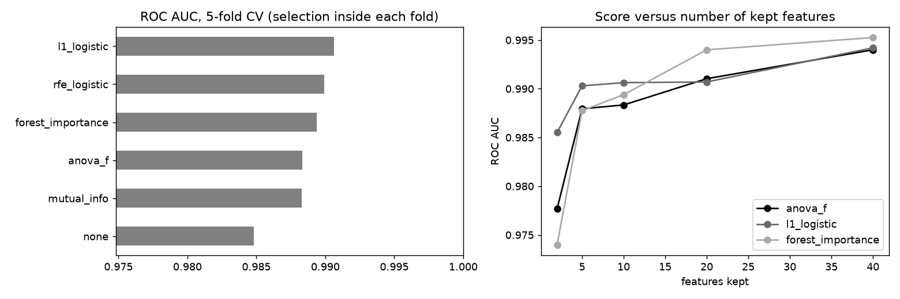

# feature-selection-benchmark

Feature selection methods compared on data with known noise: filters, L1, RFE and forest importance, with stability.

## Task

Check which selection methods remove useless features without hurting accuracy, and how stable their choices are.

## Approach

- The breast cancer dataset from scikit-learn gets 60 pure-noise columns and 10 noisy copies of real features, so the right answer is known.
- Selection runs inside each cross-validation fold through a `Pipeline`, so the held-out part never influences the choice.
- Methods: ANOVA F, mutual information, L1 logistic regression, RFE and random forest importance, against using everything.
- Stability is the mean pairwise Jaccard similarity of the selected sets over bootstrap resamples.

## Results



- 100 features of which 30 are real, 569 samples.
- AUC with 10 selected features: anova_f 0.988, mutual_info 0.988, l1_logistic 0.991, rfe_logistic 0.990, forest_importance 0.989; all features 0.985.
- No method picked a pure noise column. Stability: anova_f 0.95, mutual_info 0.77, l1_logistic 0.39, rfe_logistic 0.31, forest_importance 0.86.
- Filter methods and forest importance are stable; L1 and RFE reach similar accuracy but choose different features from resample to resample, because the real features are highly correlated.

## Run

```bash
pip install -r requirements.txt
python run.py      # generates data, runs the analysis, writes reports/
pytest             # unit tests
```

## Layout

```
src/data.py     data generation (fixed seed, no downloads)
src/core.py     analysis / model code
run.py          end-to-end script
tests/          unit tests
reports/        figures and summary.json produced by run.py
```

## Notes

The base data comes with scikit-learn, so nothing is downloaded. Numbers reproduce with the fixed seeds in the code.

Stack: scikit-learn, pandas, matplotlib.
